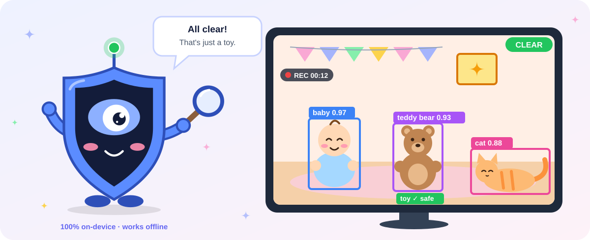
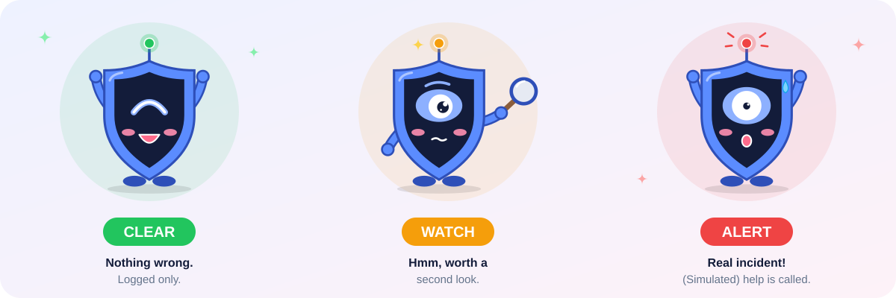
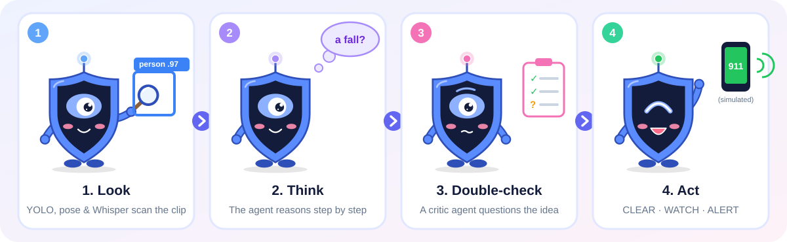

<h1 align="center">EdgeGuardian</h1>

<p align="center">
  
</p>

<p align="center">
  <b>An on-device AI agent that investigates safety incidents in video and audio recordings.</b><br>
  Built for the Edge AI Hackathon 2026 · Track: Local Agentic Systems · HP ZGX Nano (NVIDIA GB10)
</p>

<p align="center">
  
  
  
</p>

---

## What it does

Give EdgeGuardian a recording (a nursery camera, a robotaxi cabin, a shop, a street, a voicemail) and it investigates the way a careful human supervisor would. It works out where it is and who is present, looks closely only where something seems to happen, checks its own conclusion, and then decides what to do. Every model runs on the device, so it keeps working with the network unplugged.

Each investigation ends with one of three verdicts and a written report:

<p align="center">
  
</p>

> **Note:** all consequential actions are **simulated**. There are no real emergency calls and no vehicle control. The dispatch record shows exactly what would be sent, and to whom.

## How it works

<p align="center">
  
</p>

1. **Understand the scene first.** A local CLIP model infers the environment (home, nursery, vehicle, shop, street) and who is there (baby, child, adult, elderly). It also gives every weapon-like detection a second opinion, so a toddler holding a toy is never treated like an armed passenger.
2. **Look only where needed.** Cheap frame triage picks candidate windows; dense analysis (object and weapon detection, fall and slump detection from pose, speech transcription and translation, threat classifiers, acoustic events) runs only inside them. Each window produces an annotated evidence-replay clip.
3. **Build structured events**, e.g. `PERSON_01 SLUMPED_UNRESPONSIVE @ 8.0–23.5 s, conf 0.90`, linked in an evidence graph.
4. **Investigate visibly.** A ReAct agent reasons step by step and calls tools. The UI streams every *Thought → Action → Observation*.
5. **Verify before acting.** A critic agent reviews the hypothesis, and a transparent policy weighs belief, severity, consent and the cost of being wrong before any action.
6. **Remember and account.** Investigations are stored in memory, and every run logs tokens, frames skipped, latency, GPU use and an edge-vs-cloud cost comparison.

The agent's tools: `inspect_frames`, `run_vlm`, `run_pose_analysis`, `run_audio_analysis`, `translate`, `query_memory`, `retrieve_policy`, `ask_user`, `run_critic`, `propose_action` and `finalize`.

## Example scenarios

These are covered by the end-to-end tests in `tests/test_scenarios.py`:

| Situation | What EdgeGuardian does |
|---|---|
| Pregnant passenger in distress, doesn't answer | Asks in Spanish, then reroutes to the ER and calls 911 |
| Same passenger says *"estoy bien"* | Continues the route |
| Elderly person falls | Asks if they're OK, calls 911 on silence |
| Passenger with a gun | Never speaks to them; alerts police with live location |
| Caregiver strikes a baby | Notifies the parents |
| Threatening Spanish voicemail | Translates it and files a police report |
| Normal footage | Logs only, without spending a vision-model call |

## Quick start

### Option A: Rehearsal mode (any laptop, no models, about 2 minutes)

Replays annotated synthetic clips through the real agent, policy, memory and UI.

```bash
pip install -r requirements/base.txt
pip install -e . --no-deps
python scripts/make_synthetic_scenarios.py --out tests/.fixtures
python -m pytest
python -m edge_guardian serve --profile fixture     # open http://127.0.0.1:8600
```

### Option B: Windows PC with real models

Needs Python 3.11, [Ollama](https://ollama.com/download) and ffmpeg. Full walkthrough: [`START_HERE_PC.md`](START_HERE_PC.md).

```powershell
Set-ExecutionPolicy -Scope Process Bypass
.\scripts\setup_windows.ps1 -Compute CPU     # or -Compute CUDA for an NVIDIA GPU
```

This builds `EdgeGuardian.exe` and a Desktop shortcut. Double-click to open the app in its own window. Use `.\scripts\run_windows.ps1 -Web` for the browser UI instead.

### Option C: HP ZGX Nano / GB10

The vision-language model is served locally by HP ZRT (vLLM). Full walkthrough: [`START_HERE_GB10.md`](START_HERE_GB10.md).

```bash
bash scripts/setup_gb10.sh          # app environment + ./EdgeGuardian launcher
bash scripts/launch_gb10_llm.sh     # serves Qwen2.5-VL-7B-Instruct on http://127.0.0.1:8080/v1
./EdgeGuardian                      # or: WEB=1 bash scripts/run_gb10.sh  → port 8600
```

### Option D: Docker

```bash
docker build -t edge-guardian .
docker run --rm --gpus all --network host \
  -e GUARDIAN_LLM__BASE_URL=http://127.0.0.1:8080/v1 edge-guardian
```

### Command line

```bash
python -m edge_guardian analyze path/to/clip.mp4 --profile pc_cpu
python -m edge_guardian analyze clip.mp4 --profile gb10 --answer "" --json   # scripted "no answer", print report JSON
```

## Hardware profiles

Pick one with `--profile`. Any setting can be overridden with an environment variable such as `GUARDIAN_LLM__MODEL=...`.

| Profile | Hardware | Language / vision model | Notes |
|---|---|---|---|
| `fixture` | Anything | None (replay) | Tests and rehearsal; no downloads |
| `pc_cpu` | PC, no GPU | `qwen3.5:4b` via Ollama | ~1–3 min per short clip |
| `pc_gpu` | NVIDIA GPU, 8 GB+ | `qwen3.5:9b` via Ollama | Model plans every step |
| `colab` | Google Colab GPU | `qwen3.5:9b` via Ollama | Portability check |
| `gb10` | HP ZGX Nano | `Qwen2.5-VL-7B-Instruct` via ZRT | Full local stack on GPU |

## Local-first by design

- **No cloud AI client in the code.** Detection, pose, speech and classifiers run in-process; the language model runs on an OpenAI-compatible endpoint on the same machine.
- **Explicit placement policy** (`edge_guardian/edge_cloud.py`). Every computation is labelled *local* or *cloud-eligible*, with reasons. Video, audio, transcripts and location never leave the device. The default mode is `local_only`.
- **Measured, not claimed.** Each run writes `telemetry.json` with tokens, model calls, latency, frames processed and skipped, GPU stats, and the cloud-equivalent cost compared with local energy cost.

## Repository layout

```
edge_guardian/
  perception/    scene (CLIP), detector (YOLO11 + ByteTrack), pose, audio, triage, pipeline
  events/        event builder and evidence graph
  agent/         ReAct loop, tools, critic, policy, simulated actions, safety guard, LLM client
  memory/        episodic / semantic / procedural memory and caches
  server/        web backend (upload, live event stream, report, follow-up chat)
  desktop.py     native desktop window
  cli.py         command line
ui/              operator console (HTML / CSS / JS)
config/          hardware profiles (YAML)
scripts/         setup, run, model download, demo media, benchmark and training scripts
examples/        sample operator policies (childcare, site, vehicle)
data/eval/       evaluation case manifests
notebooks/       Colab notebook
installer/       Windows launcher source and icons
assets/          README illustrations
tests/           scenario and unit tests
```

## Responsible use

- No face recognition, identity inference or biometrics.
- Only analyse media you are authorised to process.
- Model weights and datasets keep their own licences. Ultralytics is AGPL-3.0; the UR Fall dataset is CC BY-NC-SA (research and demo use only).

## License

Code is released under the [Apache License 2.0](LICENSE).
